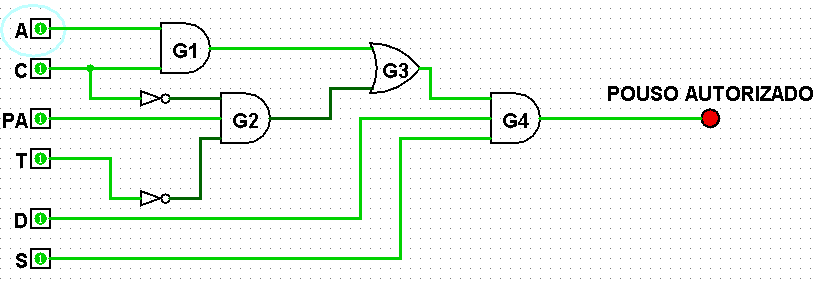
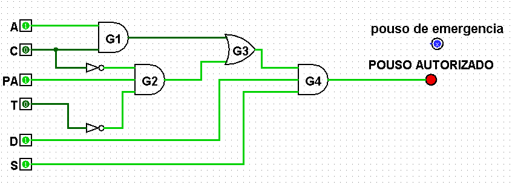

# Projeto MGPEB — Missão Aurora Siger

Simulação de pouso de módulos em Marte. Cada módulo da missão possui atributos básicos (prioridade, combustível, massa, criticidade, chegada à órbita e estado dos sensores) e passa por um conjunto de condições lógicas que decide se o pouso é autorizado, entra em alerta ou é adiado.

Projeto desenvolvido como atividade integrativa na FIAP.

## Visão geral

A missão possui **18 módulos** divididos em **5 categorias**:

| Categoria | Códigos |
|---|---|
| Habitação | HAB-01 a HAB-04 |
| Energia | ENE-01 a ENE-04 |
| Laboratório | LAB-01 a LAB-03 |
| Logística | LOG-01 a LOG-04 |
| Suporte médico | MED-01 a MED-03 |

A **prioridade** vai de 1 a 5, sendo 5 a mais importante. Os módulos essenciais recebem as maiores prioridades — por exemplo, Energia, já que sem ela os demais módulos não funcionam.

Alguns módulos foram registrados de propósito com **sensores em falha** (`ENE-04` e `LAB-01`) para testar o funcionamento dos alertas.

Os módulos são organizados em **estruturas lineares**.

## Estrutura do repositório

```
Projeto-MGPEB/
├── assets/
│   ├── aprovado.png              # circuito do pouso autorizado
│   └── emergencia.png            # circuito de alerta / adiado
├── estruturas_lineares.md        # variáveis booleanas e expressões lógicas
├── modulos_pouso.md              # tabela com os 18 módulos
├── tabela_pouso_aprovado.md      # tabela verdade do pouso autorizado (P)
├── tabela_pouso_alerta.md        # tabela verdade de alerta e adiado
└── README.md
```

## Módulos de pouso

A tabela completa está em [modulos_pouso.md](modulos_pouso.md). Atributos de cada módulo:

| Atributo | Descrição |
|---|---|
| Código | Identificador do módulo (ex.: `HAB-01`) |
| Tipo de carga | Habitação, Energia, Laboratório, Logística ou Suporte médico |
| Prioridade | De 1 (menor) a 5 (maior) |
| Combustível | Percentual de combustível restante |
| Massa (kg) | Massa do módulo |
| Criticidade | De 1 a 5 |
| Chegada à órbita | Horário de chegada |
| Sensores | `OK` ou `FALHA` |

## Lógica de decisão

As condições de pouso foram convertidas em 6 variáveis booleanas, calculadas para cada módulo:

| Var. | Significado | Condição simulada | Origem do dado |
|---|---|---|---|
| C | Combustível suficiente | combustível ≥ 30 % | Módulo |
| A | Atmosfera aceitável | vento ≤ 15 m/s | Estação meteorológica simulada |
| T | Tempestade severa | vento > 25 m/s | Estação meteorológica simulada |
| D | Pista de pouso disponível | pistas livres | Estado da base |
| S | Sensores íntegros | diagnóstico sem falhas | Módulo |
| PA | Prioridade alta | prioridade ≥ 4 | Módulo |

Notação: `·` = AND, `+` = OR, `¬` = NOT.

```
N = C · A · D · S              (pouso normal)
E = PA · ¬C · D · S · ¬T       (pouso de emergência)
P = N + E                      (pouso autorizado)

ALERTA = ¬P · (¬S + ¬C)
ADIADO = ¬P · S · C
```

- Tabela verdade do pouso autorizado: [tabela_pouso_aprovado.md](tabela_pouso_aprovado.md)
- Tabela verdade de alerta e adiado: [tabela_pouso_alerta.md](tabela_pouso_alerta.md)
- Detalhes das variáveis e dos circuitos: [estruturas_lineares.md](estruturas_lineares.md)




## Como rodar o código (passo a passo)

### 1. Pré-requisitos

- [Git](https://git-scm.com/downloads)
- [Python 3.10 ou superior](https://www.python.org/downloads/)

Confira se estão instalados:

```bash
git --version
python --version
```

> No Linux e no macOS, use `python3` no lugar de `python` se o comando acima não funcionar.

### 2. Clonar o repositório

```bash
git clone https://github.com/pietromaimone/Projeto-MGPEB.git
cd Projeto-MGPEB
```
### 3. Instalar dependências

Se o projeto tiver um arquivo `requirements.txt`:

```bash
pip install -r requirements.txt
```

Se não houver o arquivo, o programa usa apenas a biblioteca padrão do Python e este passo pode ser pulado.

### 4. Executar a simulação

```bash
python mgpeb.py
```


