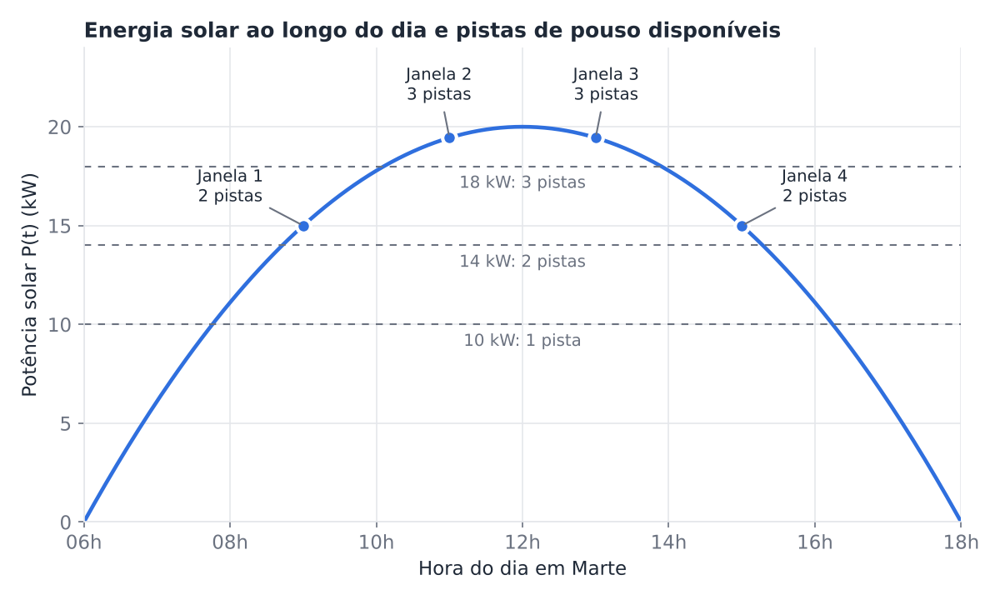
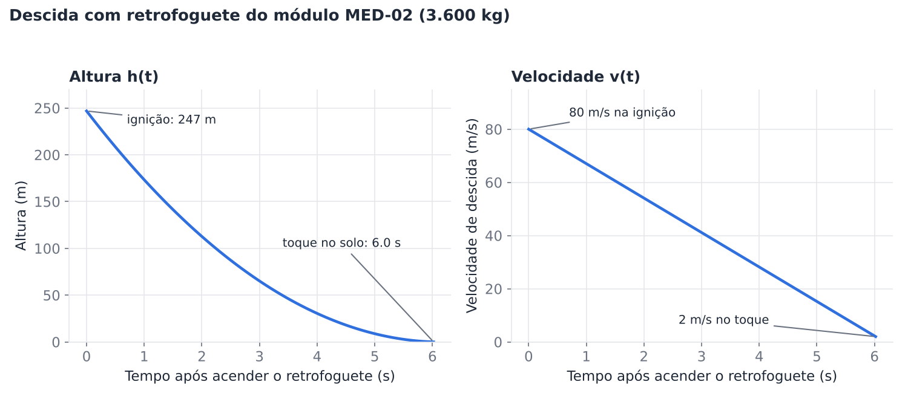

# Modelagem matemática do pouso

Aqui a gente explica a matemática por trás de duas decisões do MGPEB:

1. **Quantos módulos podem pousar ao mesmo tempo** (depende da energia solar).
2. **A que altura o motor precisa ser ligado** para o módulo pousar devagar (depende da massa do módulo).

Os números (potência dos painéis, empuxo do motor etc.) foram inventados para a simulação. As funções estão no código, no arquivo `mgpeb.py`.

---

## 1. Energia solar durante o dia

O sol nasce, a energia dos painéis vai subindo até o meio-dia e depois vai caindo até o pôr do sol. Esse desenho é uma **parábola**, ou seja, uma função quadrática.

```
P(t) = 20 · (1 − ((t − 12) / 6)²)
```

- **P(t):** energia que os painéis geram na hora t, em kW
- **t:** hora do dia, de 6 h até 18 h
- **20:** energia máxima (kW), que acontece ao meio-dia
- **12:** hora em que a energia é máxima
- **6:** quantas horas vão do meio-dia até o nascer e o pôr do sol (6 h e 18 h)

### Da energia às pistas de pouso

A base gasta 6 kW o tempo todo e cada pouso gasta mais 4 kW. Então a energia que sobra diz quantos pousos cabem ao mesmo tempo:

```
pistas = (P(t) − 6) / 4        (só a parte inteira)
```

| Hora  | Energia (kW) | Pistas |
| ----- | ------------ | ------ |
| 07 h  | 6,11         | 0      |
| 08 h  | 11,11        | 1      |
| 09 h  | 15,00        | 2      |
| 10 h  | 17,78        | 2      |
| 11 h  | 19,44        | 3      |
| 12 h  | 20,00        | 3      |

Depois do meio-dia tudo se repete ao contrário: 13 h é igual a 11 h, 14 h é igual a 10 h, e assim por diante.

Resumindo os horários:

- **Pelo menos 1 pista:** das 7,8 h às 16,2 h
- **Pelo menos 2 pistas:** das 8,7 h às 15,3 h
- **3 pistas:** das 10,1 h às 13,9 h



### Como ler o gráfico

- A curva sobe até o meio-dia e desce depois, como um morro. Ela é igual dos dois lados.
- Perto do meio-dia a energia quase não muda, mas longe dele muda muito. Uma hora antes ou depois do pico perde só 0,56 kW. Três horas perde 5 kW. Cinco horas perde quase tudo (13,9 kW).
- **Se o pico diminuir** (por exemplo, poeira nos painéis), a curva inteira desce e sobram menos pistas. Com pico de 10 kW cabe só 1 pouso. Com 6 kW ou menos, nenhum.
- **Se o pico aumentar** (mais painéis), sobram mais pistas e a janela de pouso fica maior.
- **Se a base gastar mais energia**, também sobram menos pistas.

### Como isso ajuda o MGPEB

- **Limita os pousos ao mesmo tempo.** O número de pistas vira a variável **D** (pista disponível) da regra lógica. Quando as pistas acabam, o módulo é adiado com o motivo "sem pista livre".
- **Mostra o melhor horário.** Entre 10 h e 14 h há 3 pistas, então os módulos mais importantes devem pousar nessa faixa. Antes das 7,8 h e depois das 16,2 h não tem energia para nenhum pouso.
- **Explica a simulação.** Nas quatro janelas a energia ofereceu 10 pistas no total (2, 3, 3 e 2), mas só 5 módulos pousaram. O vento atrapalhou: na janela 2 (22 m/s) só passa pouso de emergência e na janela 3 (28 m/s, tempestade) ninguém pousa.

---

## 2. Descida com retrofoguete

Perto do chão, o módulo liga o motor para frear. A meta é tocar o solo devagar, a 2 m/s.

```
a = F / m − g                       quanto o módulo freia a cada segundo

v(t) = v0 − a · t                   velocidade (linha reta)

h(t) = h_ign − v0 · t + (a/2) · t²  altura (parábola)

h_ign = (v0² − v_toque²) / (2 · a)  altura em que o motor deve ligar
```

- **F:** força do motor (empuxo), 60.000 N
- **m:** massa do módulo, em kg
- **g:** gravidade de Marte, 3,71 m/s². Ela continua puxando o módulo para baixo, por isso entra na conta
- **a:** quanto o módulo realmente freia por segundo
- **v0:** velocidade quando o motor liga, 80 m/s
- **v_toque:** velocidade ao tocar o solo, 2 m/s
- **h_ign:** altura em que o motor deve ser ligado
- **t:** tempo desde que o motor ligou, em segundos

Três exemplos com módulos do projeto:

| Módulo | Massa (kg) | Freia (m/s²) | Ligar o motor a | Tempo até o chão |
| ------ | ---------- | ------------ | --------------- | ---------------- |
| MED-02 | 3.600      | 12,96        | 247 m           | 6,0 s            |
| HAB-04 | 7.100      | 4,74         | 675 m           | 16,5 s           |
| LOG-03 | 10.500     | 2,00         | 1.596 m         | 38,9 s           |

Com esse motor, o módulo mais pesado que dá para frear tem cerca de 16.173 kg. Acima disso o motor não vence a gravidade e o módulo não freia.



### Como ler o gráfico (módulo MED-02)

- **Velocidade:** é uma reta descendo. A velocidade cai igual a cada segundo, de 80 m/s para 2 m/s em uns 6 segundos.
- **Altura:** o módulo começa caindo rápido (uns 73 m no primeiro segundo) e termina quase parado (menos de 9 m no último segundo). A curva chega ao chão quase deitada, que é o que a gente quer para um pouso suave.
- **Módulo mais pesado:** freia menos, então precisa de mais altura e mais tempo. O HAB-04 pesa quase o dobro do MED-02 e precisa de cerca de 2,7 vezes mais altura.
- **Descida mais rápida:** a altura necessária cresce bem mais que a velocidade. Se o MED-02 chegar a 100 m/s em vez de 80 m/s (25% a mais), o motor precisa ligar a 386 m em vez de 247 m (56% a mais).
- **Motor mais forte:** freia mais, então precisa de menos altura e menos tempo.

### Como isso ajuda o MGPEB

- **Quando ligar o motor.** Cada módulo tem a sua altura, porque depende da massa. Ligando abaixo dela, o módulo chega ao chão rápido demais. Ligando muito acima, o motor queima por mais tempo e gasta combustível à toa. Uma sugestão é ligar um pouco acima da altura calculada, para ter uma folga.
- **Sensores (variável S).** Para saber a altura certa, o sistema depende dos sensores. Se eles falham, o módulo não é autorizado e vai para a lista de alerta, como acontece com o ENE-04 e o LAB-01 na simulação.
- **Combustível mínimo (variável C).** O LOG-03 queima o motor por 39 s, enquanto o MED-02 queima por 6 s. Por isso o sistema pede um mínimo de combustível (30%, valor que a gente definiu) antes de autorizar.
- **Paraquedas.** A atmosfera de Marte é muito fina, então o paraquedas sozinho não segura módulos pesados. Ele serve para baixar a velocidade até uns 80 m/s antes de ligar o motor. Como a altura necessária cresce rápido com a velocidade, vale abrir o paraquedas cedo.

---

## O que o modelo não considera

- A massa do módulo é fixa. Na vida real ela diminui conforme o combustível é queimado.
- Não tem atrito com o ar nem vento durante a descida.
- A energia solar não considera poeira nos painéis. 
